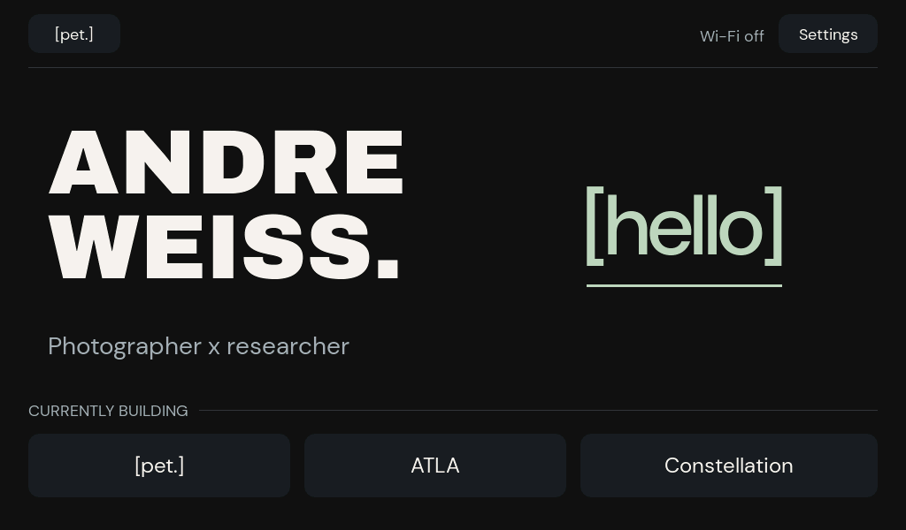

# [pet.]

**A wearable introduction.** A personal engagement tool built around a small touchscreen, a hello, and a conversation that can continue after the first meeting.

[Explore the interactive OS preview →](https://mindofaxd.com/pet)



## The idea

[pet.] runs a personal OS on the Waveshare ESP32-S3-Touch-LCD-5B. Its home screen brings together Hello, personal projects, and Constellation photo studies.

Hello displays an encounter-specific QR code. A guest introduces themselves on their phone, PET receives the introduction over Wi-Fi, and a supported NFC sticker can carry a permanent card link. The guest chooses whether to share a conversation topic on the card page.

The [Mind of AXD preview](https://mindofaxd.com/pet) lets you explore the OS in a browser. Phone, Wi-Fi, and card events are simulated; it does not create live introductions or write tags.

## Flash the badge

PET firmware is flashed to the board's **onboard memory over USB**. You do not need to format a drive or write an SD-card image.

These commands follow the project's **macOS** tooling. You'll need the Waveshare ESP32-S3-Touch-LCD-5B, a USB data cable, Git, Python 3.12 or 3.13, CMake, Ninja, and dfu-util. See [Espressif's macOS prerequisites](https://docs.espressif.com/projects/esp-idf/en/v5.4.2/esp32s3/get-started/linux-macos-setup.html) if you're setting up a new machine.

### 1. Get the source and install the tools

```sh
git clone https://github.com/vworping/pet.git
cd pet
brew install cmake ninja dfu-util python@3.13
./scripts/setup.sh
```

The setup script installs **ESP-IDF v5.4.2** and the ESP32-S3 toolchain. If using Python 3.12, run `PET_PYTHON=python3.12 ./scripts/setup.sh` instead.

### 2. Build

```sh
./scripts/build.sh
```

Wait for a successful build. The script stages the firmware in `/private/tmp/pet-v4-build` so ESP-IDF can build from a path without spaces.

### 3. Connect and flash

Connect the board's USB programming port to your Mac with a data cable. Close any serial monitor, then run:

```sh
./scripts/flash.sh
```

This replaces the firmware currently on the board. Leave the USB cable connected until writing and hash verification finish.

### 4. Check startup

```sh
./scripts/monitor.sh
```

Look for the PET home screen on the display and startup messages in the monitor. Exit the monitor with **Ctrl + ]**. Configure Wi-Fi through **Settings → Wi-Fi** on the badge.

**Live Hello requires separate service provisioning.** Flashing firmware doesn't install a hosted service or configure a device key. See [Public Hello setup](docs/PUBLIC-HELLO.md) and the [hosted service guide](cards/hosted/README.md). NFC also requires the compatible reader and supported tags; see [NFC hardware notes](docs/NFC-HARDWARE.md).

### Troubleshooting

- **No board found or multiple ports:** run `python3 scripts/port.py`. The helper lists detected ports when it cannot select exactly one. Set `PET_PORT` to your actual device path for both flash and monitor:

  ```sh
  PET_PORT=/dev/cu.usbmodem101 ./scripts/flash.sh
  PET_PORT=/dev/cu.usbmodem101 ./scripts/monitor.sh
  ```

  The port above is an example. Use a known USB data cable and the programming port. If necessary, hold **BOOT**, press and release **RESET**, release **BOOT**, then retry. See [Espressif's connection troubleshooting](https://docs.espressif.com/projects/esptool/en/latest/esp32s3/troubleshooting.html).
- **ESP-IDF missing after it worked previously:** setup, toolchain, and build defaults live under `/private/tmp`, which macOS may clear. Rerun setup and build, or export persistent, space-free `PET_IDF_PATH`, `PET_IDF_TOOLS_PATH`, and `PET_BUILD_ROOT` paths before running the scripts.
- **Another operating system:** this first pass documents macOS. The scripts assume macOS paths and serial devices. Follow the [ESP-IDF v5.4.2 guide](https://docs.espressif.com/projects/esp-idf/en/v5.4.2/esp32s3/get-started/index.html) and adapt the paths and port selection for your platform.

## 3D enclosure

Coming later: enclosure files, print settings, and assembly notes. This first pass focuses on the OS preview and getting the badge running.

## Project notes

- [Wi-Fi and eduroam setup](docs/WIFI.md)
- [Public Hello setup, provisioning, and verification](docs/PUBLIC-HELLO.md)
- [Hosted service](cards/hosted/README.md)
- [NFC hardware history](docs/NFC-HARDWARE.md)
- [Third-party sources and licenses](docs/THIRD_PARTY.md)

Current limits: the UMB eduroam profile still needs an on-campus connection test; the automatic blank-sticker flow still needs a physical card interaction check. No verified battery-voltage input is available. See the [6.20261013.1 release verification](docs/RELEASE-6.20261013.1.md) for the current build, device, and website checks. Venue networks requiring browser sign-in need venue assistance or a permitted hotspot.

No project-wide software license has been selected; third-party licenses remain applicable.
